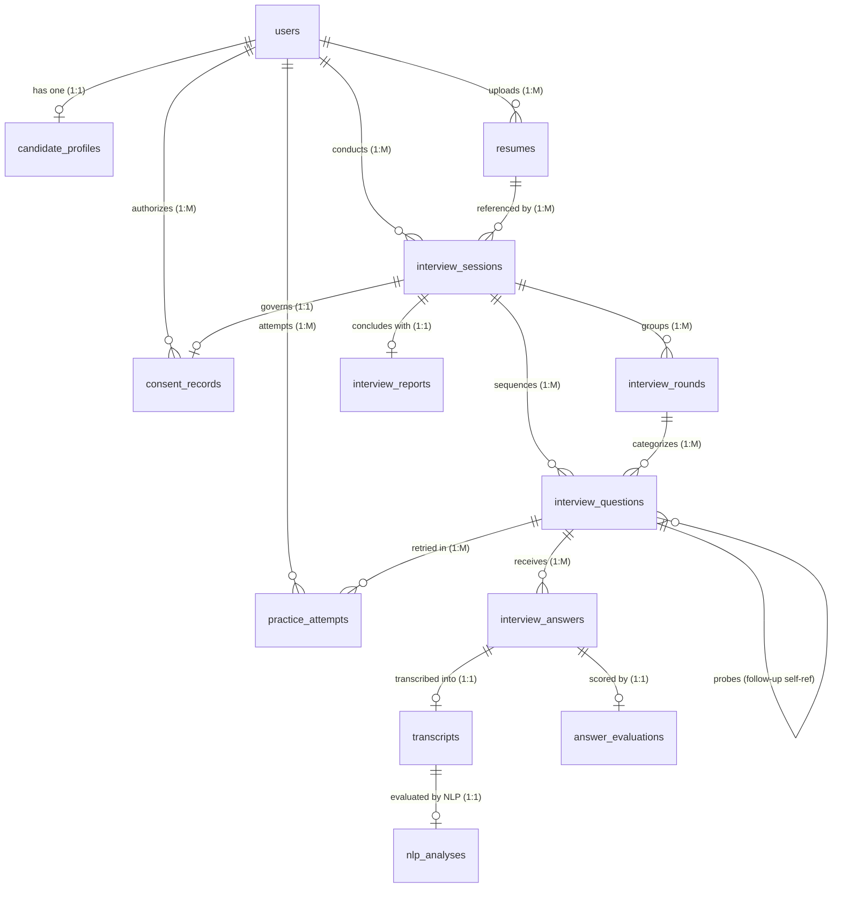

# Adaptive AI Mock Interview System - Database Schema Specification

**Database File Path:** `C:\Users\likit\adaptive-ai-mock-interview\backend\interview_app.db`  
**Database Engine:** SQLite 3 (Async via `aiosqlite`)  
**ORM:** SQLAlchemy 2.0 Async (Declarative Base in `app.models.entities`)  
**Extraction Timestamp:** 2026-10-25T14:06:49.893790  
**Inspection Mode:** Read-Only (`mode=ro`, zero write operations executed)  

---

## 1. Executive Summary & Table Inventory

The inspection identified **14 tables**, **0 views**, and **0 triggers** in the active SQLite database.

| Table Name | Row Count | Column Count | Foreign Keys | Indexes / Uniques | Primary Role in Application |
| :--- | :---: | :---: | :---: | :---: | :--- |
| **`answer_evaluations`** | 314 | 15 | 1 | 2 | 5-dimension rubric scores, evidence quotes, missing concepts. |
| **`candidate_profiles`** | 7 | 9 | 1 | 2 | Extended candidate bio, target roles, experience level. |
| **`consent_records`** | 29 | 7 | 2 | 2 | Explicit candidate consent timestamps for camera and microphone. |
| **`interview_answers`** | 314 | 7 | 2 | 3 | Candidate recorded audio paths, duration, and fallback flags. |
| **`interview_questions`** | 354 | 14 | 3 | 2 | Ordered question sequence, adaptive difficulty, follow-up trees. |
| **`interview_reports`** | 3 | 17 | 1 | 2 | Overall synthesis, competency averages, strengths, weaknesses. |
| **`interview_rounds`** | 37 | 5 | 1 | 2 | Target interview rounds (technical, HR, behavioral, situational). |
| **`interview_sessions`** | 10 | 15 | 2 | 2 | Interview lifecycle (draft, active, completed), difficulty, scores. |
| **`model_versions`** | 0 | 6 | 0 | 1 | Audit log of AI / NLP model versions and operational parameters. |
| **`nlp_analyses`** | 314 | 10 | 1 | 2 | Intent classification, concept presence, and semantic relevance. |
| **`practice_attempts`** | 0 | 9 | 2 | 2 | Targeted question re-attempts with comparative improvement. |
| **`resumes`** | 3 | 14 | 1 | 2 | Uploaded candidate resume files, parsed skills, and job matches. |
| **`transcripts`** | 314 | 7 | 1 | 2 | Speech-to-text transcriptions, confidence scores, quality flags. |
| **`users`** | 7 | 6 | 0 | 2 | Core candidate credentials, email uniqueness, activation status. |

---

## 2. Entity-Relationship Architecture & Hierarchies

The database exhibits a clear hierarchical architecture organized around candidates (`users`), their profiles, resumes, and complete interview lifecycle trees:



### Relationship Categorization

1. **One-to-One (1:1) Relationships (Enforced by UNIQUE constraints on Foreign Keys):**
   - `users.id` <-> `candidate_profiles.user_id` (Unique foreign key on `user_id`)
   - `interview_sessions.id` <-> `interview_reports.session_id` (Unique foreign key on `session_id`)
   - `interview_answers.id` <-> `transcripts.answer_id` (Unique foreign key on `answer_id`)
   - `transcripts.id` <-> `nlp_analyses.transcript_id` (Unique foreign key on `transcript_id`)
   - `interview_answers.id` <-> `answer_evaluations.answer_id` (Unique foreign key on `answer_id`)
2. **One-to-Many (1:M) Relationships:**
   - `users.id` -> `resumes.user_id`
   - `users.id` -> `interview_sessions.user_id`
   - `users.id` -> `practice_attempts.user_id`
   - `users.id` -> `consent_records.user_id`
   - `resumes.id` -> `interview_sessions.resume_id` (`ON DELETE SET NULL`)
   - `interview_sessions.id` -> `interview_rounds.session_id`
   - `interview_sessions.id` -> `interview_questions.session_id`
   - `interview_rounds.id` -> `interview_questions.round_id`
   - `interview_questions.id` -> `interview_answers.question_id`
   - `interview_questions.id` -> `practice_attempts.original_question_id`
3. **Self-Referential / Hierarchical Relationships:**
   - `interview_questions.parent_question_id` -> `interview_questions.id` (`ON DELETE SET NULL`), enabling adaptive follow-up question trees.

---

## 3. Detailed Table Specifications & Schemas

### 3.1. Table: `answer_evaluations`

- **Purpose:** 5-dimension rubric scores, evidence quotes, missing concepts.
- **Active Row Count:** `314` rows

#### Columns

| Column Name | SQLite Data Type | Nullable | Default Value | Primary Key | Description & Notes |
| :--- | :--- | :---: | :--- | :---: | :--- |
| **`id`** | `VARCHAR(36)` | No | *None* | **PK** | UUID v4 string identifier |
| **`answer_id`** | `VARCHAR(36)` | No | *None* |  | Foreign key reference |
| **`technical_score`** | `INTEGER` | Yes | *None* |  |  |
| **`relevance_score`** | `INTEGER` | Yes | *None* |  |  |
| **`completeness_score`** | `INTEGER` | Yes | *None* |  |  |
| **`problem_solving_score`** | `INTEGER` | Yes | *None* |  |  |
| **`communication_score`** | `INTEGER` | Yes | *None* |  |  |
| **`overall_answer_score`** | `FLOAT` | Yes | *None* |  |  |
| **`justifications`** | `JSON` | Yes | *None* |  | Stores serialized JSON structure |
| **`evidence_quotes`** | `JSON` | Yes | *None* |  | Stores serialized JSON structure |
| **`missing_concepts`** | `JSON` | Yes | *None* |  | Stores serialized JSON structure |
| **`unsupported_claims`** | `JSON` | Yes | *None* |  | Stores serialized JSON structure |
| **`insufficient_evidence`** | `BOOLEAN` | Yes | *None* |  |  |
| **`evaluator_model`** | `VARCHAR(64)` | Yes | *None* |  |  |
| **`created_at`** | `DATETIME` | Yes | *None* |  | UTC DateTime timestamp |

#### Foreign Keys

| Column | References | On Delete | On Update | Constraint Details |
| :--- | :--- | :--- | :--- | :--- |
| **`answer_id`** | `interview_answers(id)` | `CASCADE` | `NO ACTION` | Foreign key constraint linking to `interview_answers` |

#### Indexes & Unique Constraints

| Index Name | Indexed Columns | Unique? | Origin / Type |
| :--- | :--- | :---: | :--- |
| `sqlite_autoindex_answer_evaluations_2` | `answer_id` | **Yes** | Unique Constraint |
| `sqlite_autoindex_answer_evaluations_1` | `id` | **Yes** | Primary Key |

#### SQLite CREATE TABLE DDL

```sql
CREATE TABLE answer_evaluations (
	id VARCHAR(36) NOT NULL, 
	answer_id VARCHAR(36) NOT NULL, 
	technical_score INTEGER, 
	relevance_score INTEGER, 
	completeness_score INTEGER, 
	problem_solving_score INTEGER, 
	communication_score INTEGER, 
	overall_answer_score FLOAT, 
	justifications JSON, 
	evidence_quotes JSON, 
	missing_concepts JSON, 
	unsupported_claims JSON, 
	insufficient_evidence BOOLEAN, 
	evaluator_model VARCHAR(64), 
	created_at DATETIME, 
	PRIMARY KEY (id), 
	UNIQUE (answer_id), 
	FOREIGN KEY(answer_id) REFERENCES interview_answers (id) ON DELETE CASCADE
);
```

---

### 3.2. Table: `candidate_profiles`

- **Purpose:** Extended candidate bio, target roles, experience level.
- **Active Row Count:** `7` rows

#### Columns

| Column Name | SQLite Data Type | Nullable | Default Value | Primary Key | Description & Notes |
| :--- | :--- | :---: | :--- | :---: | :--- |
| **`id`** | `VARCHAR(36)` | No | *None* | **PK** | UUID v4 string identifier |
| **`user_id`** | `VARCHAR(36)` | No | *None* |  | Foreign key reference |
| **`full_name`** | `VARCHAR(255)` | Yes | *None* |  |  |
| **`education`** | `VARCHAR(255)` | Yes | *None* |  |  |
| **`years_of_experience`** | `FLOAT` | Yes | *None* |  |  |
| **`current_role`** | `VARCHAR(255)` | Yes | *None* |  |  |
| **`target_role`** | `VARCHAR(255)` | Yes | *None* |  |  |
| **`bio`** | `TEXT` | Yes | *None* |  |  |
| **`updated_at`** | `DATETIME` | Yes | *None* |  | UTC DateTime timestamp |

#### Foreign Keys

| Column | References | On Delete | On Update | Constraint Details |
| :--- | :--- | :--- | :--- | :--- |
| **`user_id`** | `users(id)` | `CASCADE` | `NO ACTION` | Foreign key constraint linking to `users` |

#### Indexes & Unique Constraints

| Index Name | Indexed Columns | Unique? | Origin / Type |
| :--- | :--- | :---: | :--- |
| `sqlite_autoindex_candidate_profiles_2` | `user_id` | **Yes** | Unique Constraint |
| `sqlite_autoindex_candidate_profiles_1` | `id` | **Yes** | Primary Key |

#### SQLite CREATE TABLE DDL

```sql
CREATE TABLE candidate_profiles (
	id VARCHAR(36) NOT NULL, 
	user_id VARCHAR(36) NOT NULL, 
	full_name VARCHAR(255), 
	education VARCHAR(255), 
	years_of_experience FLOAT, 
	current_role VARCHAR(255), 
	target_role VARCHAR(255), 
	bio TEXT, 
	updated_at DATETIME, 
	PRIMARY KEY (id), 
	UNIQUE (user_id), 
	FOREIGN KEY(user_id) REFERENCES users (id) ON DELETE CASCADE
);
```

---

### 3.3. Table: `consent_records`

- **Purpose:** Explicit candidate consent timestamps for camera and microphone.
- **Active Row Count:** `29` rows

#### Columns

| Column Name | SQLite Data Type | Nullable | Default Value | Primary Key | Description & Notes |
| :--- | :--- | :---: | :--- | :---: | :--- |
| **`id`** | `VARCHAR(36)` | No | *None* | **PK** | UUID v4 string identifier |
| **`user_id`** | `VARCHAR(36)` | No | *None* |  | Foreign key reference |
| **`session_id`** | `VARCHAR(36)` | Yes | *None* |  | Foreign key reference |
| **`camera_consent`** | `BOOLEAN` | Yes | *None* |  |  |
| **`mic_consent`** | `BOOLEAN` | Yes | *None* |  |  |
| **`data_retention_acknowledged`** | `BOOLEAN` | Yes | *None* |  |  |
| **`timestamp`** | `DATETIME` | Yes | *None* |  | UTC DateTime timestamp |

#### Foreign Keys

| Column | References | On Delete | On Update | Constraint Details |
| :--- | :--- | :--- | :--- | :--- |
| **`session_id`** | `interview_sessions(id)` | `CASCADE` | `NO ACTION` | Foreign key constraint linking to `interview_sessions` |
| **`user_id`** | `users(id)` | `CASCADE` | `NO ACTION` | Foreign key constraint linking to `users` |

#### Indexes & Unique Constraints

| Index Name | Indexed Columns | Unique? | Origin / Type |
| :--- | :--- | :---: | :--- |
| `ix_consent_records_user_id` | `user_id` | No | Explicit Index |
| `sqlite_autoindex_consent_records_1` | `id` | **Yes** | Primary Key |

#### SQLite CREATE TABLE DDL

```sql
CREATE TABLE consent_records (
	id VARCHAR(36) NOT NULL, 
	user_id VARCHAR(36) NOT NULL, 
	session_id VARCHAR(36), 
	camera_consent BOOLEAN, 
	mic_consent BOOLEAN, 
	data_retention_acknowledged BOOLEAN, 
	timestamp DATETIME, 
	PRIMARY KEY (id), 
	FOREIGN KEY(user_id) REFERENCES users (id) ON DELETE CASCADE, 
	FOREIGN KEY(session_id) REFERENCES interview_sessions (id) ON DELETE CASCADE
);
```

---

### 3.4. Table: `interview_answers`

- **Purpose:** Candidate recorded audio paths, duration, and fallback flags.
- **Active Row Count:** `314` rows

#### Columns

| Column Name | SQLite Data Type | Nullable | Default Value | Primary Key | Description & Notes |
| :--- | :--- | :---: | :--- | :---: | :--- |
| **`id`** | `VARCHAR(36)` | No | *None* | **PK** | UUID v4 string identifier |
| **`question_id`** | `VARCHAR(36)` | No | *None* |  | Foreign key reference |
| **`session_id`** | `VARCHAR(36)` | No | *None* |  | Foreign key reference |
| **`audio_path`** | `VARCHAR(512)` | Yes | *None* |  |  |
| **`duration_seconds`** | `FLOAT` | Yes | *None* |  |  |
| **`is_text_fallback`** | `BOOLEAN` | Yes | *None* |  |  |
| **`created_at`** | `DATETIME` | Yes | *None* |  | UTC DateTime timestamp |

#### Foreign Keys

| Column | References | On Delete | On Update | Constraint Details |
| :--- | :--- | :--- | :--- | :--- |
| **`session_id`** | `interview_sessions(id)` | `CASCADE` | `NO ACTION` | Foreign key constraint linking to `interview_sessions` |
| **`question_id`** | `interview_questions(id)` | `CASCADE` | `NO ACTION` | Foreign key constraint linking to `interview_questions` |

#### Indexes & Unique Constraints

| Index Name | Indexed Columns | Unique? | Origin / Type |
| :--- | :--- | :---: | :--- |
| `ix_interview_answers_question_id` | `question_id` | No | Explicit Index |
| `ix_interview_answers_session_id` | `session_id` | No | Explicit Index |
| `sqlite_autoindex_interview_answers_1` | `id` | **Yes** | Primary Key |

#### SQLite CREATE TABLE DDL

```sql
CREATE TABLE interview_answers (
	id VARCHAR(36) NOT NULL, 
	question_id VARCHAR(36) NOT NULL, 
	session_id VARCHAR(36) NOT NULL, 
	audio_path VARCHAR(512), 
	duration_seconds FLOAT, 
	is_text_fallback BOOLEAN, 
	created_at DATETIME, 
	PRIMARY KEY (id), 
	FOREIGN KEY(question_id) REFERENCES interview_questions (id) ON DELETE CASCADE, 
	FOREIGN KEY(session_id) REFERENCES interview_sessions (id) ON DELETE CASCADE
);
```

---

### 3.5. Table: `interview_questions`

- **Purpose:** Ordered question sequence, adaptive difficulty, follow-up trees.
- **Active Row Count:** `354` rows

#### Columns

| Column Name | SQLite Data Type | Nullable | Default Value | Primary Key | Description & Notes |
| :--- | :--- | :---: | :--- | :---: | :--- |
| **`id`** | `VARCHAR(36)` | No | *None* | **PK** | UUID v4 string identifier |
| **`session_id`** | `VARCHAR(36)` | No | *None* |  | Foreign key reference |
| **`round_id`** | `VARCHAR(36)` | Yes | *None* |  | Foreign key reference |
| **`parent_question_id`** | `VARCHAR(36)` | Yes | *None* |  | Foreign key reference |
| **`question_text`** | `TEXT` | No | *None* |  |  |
| **`difficulty`** | `INTEGER` | Yes | *None* |  |  |
| **`competency_focus`** | `VARCHAR(128)` | Yes | *None* |  |  |
| **`expected_concepts`** | `JSON` | Yes | *None* |  | Stores serialized JSON structure |
| **`source_reference`** | `VARCHAR(255)` | Yes | *None* |  |  |
| **`order_index`** | `INTEGER` | Yes | *None* |  |  |
| **`is_followup`** | `BOOLEAN` | Yes | *None* |  |  |
| **`follow_up_count`** | `INTEGER` | Yes | *None* |  |  |
| **`status`** | `VARCHAR(32)` | Yes | *None* |  |  |
| **`created_at`** | `DATETIME` | Yes | *None* |  | UTC DateTime timestamp |

#### Foreign Keys

| Column | References | On Delete | On Update | Constraint Details |
| :--- | :--- | :--- | :--- | :--- |
| **`parent_question_id`** | `interview_questions(id)` | `SET NULL` | `NO ACTION` | Foreign key constraint linking to `interview_questions` |
| **`round_id`** | `interview_rounds(id)` | `CASCADE` | `NO ACTION` | Foreign key constraint linking to `interview_rounds` |
| **`session_id`** | `interview_sessions(id)` | `CASCADE` | `NO ACTION` | Foreign key constraint linking to `interview_sessions` |

#### Indexes & Unique Constraints

| Index Name | Indexed Columns | Unique? | Origin / Type |
| :--- | :--- | :---: | :--- |
| `ix_interview_questions_session_id` | `session_id` | No | Explicit Index |
| `sqlite_autoindex_interview_questions_1` | `id` | **Yes** | Primary Key |

#### SQLite CREATE TABLE DDL

```sql
CREATE TABLE interview_questions (
	id VARCHAR(36) NOT NULL, 
	session_id VARCHAR(36) NOT NULL, 
	round_id VARCHAR(36), 
	parent_question_id VARCHAR(36), 
	question_text TEXT NOT NULL, 
	difficulty INTEGER, 
	competency_focus VARCHAR(128), 
	expected_concepts JSON, 
	source_reference VARCHAR(255), 
	order_index INTEGER, 
	is_followup BOOLEAN, 
	follow_up_count INTEGER, 
	status VARCHAR(32), 
	created_at DATETIME, 
	PRIMARY KEY (id), 
	FOREIGN KEY(session_id) REFERENCES interview_sessions (id) ON DELETE CASCADE, 
	FOREIGN KEY(round_id) REFERENCES interview_rounds (id) ON DELETE CASCADE, 
	FOREIGN KEY(parent_question_id) REFERENCES interview_questions (id) ON DELETE SET NULL
);
```

---

### 3.6. Table: `interview_reports`

- **Purpose:** Overall synthesis, competency averages, strengths, weaknesses.
- **Active Row Count:** `3` rows

#### Columns

| Column Name | SQLite Data Type | Nullable | Default Value | Primary Key | Description & Notes |
| :--- | :--- | :---: | :--- | :---: | :--- |
| **`id`** | `VARCHAR(36)` | No | *None* | **PK** | UUID v4 string identifier |
| **`session_id`** | `VARCHAR(36)` | No | *None* |  | Foreign key reference |
| **`overall_score`** | `FLOAT` | No | *None* |  |  |
| **`technical_avg`** | `FLOAT` | Yes | *None* |  |  |
| **`relevance_avg`** | `FLOAT` | Yes | *None* |  |  |
| **`completeness_avg`** | `FLOAT` | Yes | *None* |  |  |
| **`problem_solving_avg`** | `FLOAT` | Yes | *None* |  |  |
| **`communication_avg`** | `FLOAT` | Yes | *None* |  |  |
| **`strengths`** | `JSON` | Yes | *None* |  | Stores serialized JSON structure |
| **`weaknesses`** | `JSON` | Yes | *None* |  | Stores serialized JSON structure |
| **`missing_concepts`** | `JSON` | Yes | *None* |  | Stores serialized JSON structure |
| **`revision_topics`** | `JSON` | Yes | *None* |  | Stores serialized JSON structure |
| **`practice_exercises`** | `JSON` | Yes | *None* |  | Stores serialized JSON structure |
| **`summary`** | `TEXT` | Yes | *None* |  |  |
| **`disclaimer`** | `TEXT` | Yes | *None* |  |  |
| **`pdf_path`** | `VARCHAR(512)` | Yes | *None* |  |  |
| **`created_at`** | `DATETIME` | Yes | *None* |  | UTC DateTime timestamp |

#### Foreign Keys

| Column | References | On Delete | On Update | Constraint Details |
| :--- | :--- | :--- | :--- | :--- |
| **`session_id`** | `interview_sessions(id)` | `CASCADE` | `NO ACTION` | Foreign key constraint linking to `interview_sessions` |

#### Indexes & Unique Constraints

| Index Name | Indexed Columns | Unique? | Origin / Type |
| :--- | :--- | :---: | :--- |
| `sqlite_autoindex_interview_reports_2` | `session_id` | **Yes** | Unique Constraint |
| `sqlite_autoindex_interview_reports_1` | `id` | **Yes** | Primary Key |

#### SQLite CREATE TABLE DDL

```sql
CREATE TABLE interview_reports (
	id VARCHAR(36) NOT NULL, 
	session_id VARCHAR(36) NOT NULL, 
	overall_score FLOAT NOT NULL, 
	technical_avg FLOAT, 
	relevance_avg FLOAT, 
	completeness_avg FLOAT, 
	problem_solving_avg FLOAT, 
	communication_avg FLOAT, 
	strengths JSON, 
	weaknesses JSON, 
	missing_concepts JSON, 
	revision_topics JSON, 
	practice_exercises JSON, 
	summary TEXT, 
	disclaimer TEXT, 
	pdf_path VARCHAR(512), 
	created_at DATETIME, 
	PRIMARY KEY (id), 
	UNIQUE (session_id), 
	FOREIGN KEY(session_id) REFERENCES interview_sessions (id) ON DELETE CASCADE
);
```

---

### 3.7. Table: `interview_rounds`

- **Purpose:** Target interview rounds (technical, HR, behavioral, situational).
- **Active Row Count:** `37` rows

#### Columns

| Column Name | SQLite Data Type | Nullable | Default Value | Primary Key | Description & Notes |
| :--- | :--- | :---: | :--- | :---: | :--- |
| **`id`** | `VARCHAR(36)` | No | *None* | **PK** | UUID v4 string identifier |
| **`session_id`** | `VARCHAR(36)` | No | *None* |  | Foreign key reference |
| **`round_type`** | `VARCHAR(64)` | No | *None* |  |  |
| **`round_order`** | `INTEGER` | No | *None* |  |  |
| **`status`** | `VARCHAR(32)` | Yes | *None* |  |  |

#### Foreign Keys

| Column | References | On Delete | On Update | Constraint Details |
| :--- | :--- | :--- | :--- | :--- |
| **`session_id`** | `interview_sessions(id)` | `CASCADE` | `NO ACTION` | Foreign key constraint linking to `interview_sessions` |

#### Indexes & Unique Constraints

| Index Name | Indexed Columns | Unique? | Origin / Type |
| :--- | :--- | :---: | :--- |
| `ix_interview_rounds_session_id` | `session_id` | No | Explicit Index |
| `sqlite_autoindex_interview_rounds_1` | `id` | **Yes** | Primary Key |

#### SQLite CREATE TABLE DDL

```sql
CREATE TABLE interview_rounds (
	id VARCHAR(36) NOT NULL, 
	session_id VARCHAR(36) NOT NULL, 
	round_type VARCHAR(64) NOT NULL, 
	round_order INTEGER NOT NULL, 
	status VARCHAR(32), 
	PRIMARY KEY (id), 
	FOREIGN KEY(session_id) REFERENCES interview_sessions (id) ON DELETE CASCADE
);
```

---

### 3.8. Table: `interview_sessions`

- **Purpose:** Interview lifecycle (draft, active, completed), difficulty, scores.
- **Active Row Count:** `10` rows

#### Columns

| Column Name | SQLite Data Type | Nullable | Default Value | Primary Key | Description & Notes |
| :--- | :--- | :---: | :--- | :---: | :--- |
| **`id`** | `VARCHAR(36)` | No | *None* | **PK** | UUID v4 string identifier |
| **`user_id`** | `VARCHAR(36)` | No | *None* |  | Foreign key reference |
| **`resume_id`** | `VARCHAR(36)` | Yes | *None* |  | Foreign key reference |
| **`target_role`** | `VARCHAR(255)` | No | *None* |  |  |
| **`job_description`** | `TEXT` | Yes | *None* |  |  |
| **`status`** | `VARCHAR(32)` | Yes | *None* |  |  |
| **`starting_difficulty`** | `INTEGER` | Yes | *None* |  |  |
| **`current_difficulty`** | `INTEGER` | Yes | *None* |  |  |
| **`target_rounds`** | `JSON` | Yes | *None* |  | Stores serialized JSON structure |
| **`total_planned_questions`** | `INTEGER` | Yes | *None* |  |  |
| **`duration_minutes`** | `INTEGER` | Yes | *None* |  |  |
| **`interaction_mode`** | `VARCHAR(32)` | Yes | *None* |  |  |
| **`overall_score`** | `FLOAT` | Yes | *None* |  |  |
| **`created_at`** | `DATETIME` | Yes | *None* |  | UTC DateTime timestamp |
| **`updated_at`** | `DATETIME` | Yes | *None* |  | UTC DateTime timestamp |

#### Foreign Keys

| Column | References | On Delete | On Update | Constraint Details |
| :--- | :--- | :--- | :--- | :--- |
| **`resume_id`** | `resumes(id)` | `SET NULL` | `NO ACTION` | Foreign key constraint linking to `resumes` |
| **`user_id`** | `users(id)` | `CASCADE` | `NO ACTION` | Foreign key constraint linking to `users` |

#### Indexes & Unique Constraints

| Index Name | Indexed Columns | Unique? | Origin / Type |
| :--- | :--- | :---: | :--- |
| `ix_interview_sessions_user_id` | `user_id` | No | Explicit Index |
| `sqlite_autoindex_interview_sessions_1` | `id` | **Yes** | Primary Key |

#### SQLite CREATE TABLE DDL

```sql
CREATE TABLE interview_sessions (
	id VARCHAR(36) NOT NULL, 
	user_id VARCHAR(36) NOT NULL, 
	resume_id VARCHAR(36), 
	target_role VARCHAR(255) NOT NULL, 
	job_description TEXT, 
	status VARCHAR(32), 
	starting_difficulty INTEGER, 
	current_difficulty INTEGER, 
	target_rounds JSON, 
	total_planned_questions INTEGER, 
	duration_minutes INTEGER, 
	interaction_mode VARCHAR(32), 
	overall_score FLOAT, 
	created_at DATETIME, 
	updated_at DATETIME, 
	PRIMARY KEY (id), 
	FOREIGN KEY(user_id) REFERENCES users (id) ON DELETE CASCADE, 
	FOREIGN KEY(resume_id) REFERENCES resumes (id) ON DELETE SET NULL
);
```

---

### 3.9. Table: `model_versions`

- **Purpose:** Audit log of AI / NLP model versions and operational parameters.
- **Active Row Count:** `0` rows

#### Columns

| Column Name | SQLite Data Type | Nullable | Default Value | Primary Key | Description & Notes |
| :--- | :--- | :---: | :--- | :---: | :--- |
| **`id`** | `VARCHAR(36)` | No | *None* | **PK** | UUID v4 string identifier |
| **`component_name`** | `VARCHAR(64)` | No | *None* |  |  |
| **`version_tag`** | `VARCHAR(64)` | No | *None* |  |  |
| **`parameters`** | `JSON` | Yes | *None* |  | Stores serialized JSON structure |
| **`metrics`** | `JSON` | Yes | *None* |  | Stores serialized JSON structure |
| **`created_at`** | `DATETIME` | Yes | *None* |  | UTC DateTime timestamp |

#### Foreign Keys

*None (Root or independent table)*

#### Indexes & Unique Constraints

| Index Name | Indexed Columns | Unique? | Origin / Type |
| :--- | :--- | :---: | :--- |
| `sqlite_autoindex_model_versions_1` | `id` | **Yes** | Primary Key |

#### SQLite CREATE TABLE DDL

```sql
CREATE TABLE model_versions (
	id VARCHAR(36) NOT NULL, 
	component_name VARCHAR(64) NOT NULL, 
	version_tag VARCHAR(64) NOT NULL, 
	parameters JSON, 
	metrics JSON, 
	created_at DATETIME, 
	PRIMARY KEY (id)
);
```

---

### 3.10. Table: `nlp_analyses`

- **Purpose:** Intent classification, concept presence, and semantic relevance.
- **Active Row Count:** `314` rows

#### Columns

| Column Name | SQLite Data Type | Nullable | Default Value | Primary Key | Description & Notes |
| :--- | :--- | :---: | :--- | :---: | :--- |
| **`id`** | `VARCHAR(36)` | No | *None* | **PK** | UUID v4 string identifier |
| **`transcript_id`** | `VARCHAR(36)` | No | *None* |  | Foreign key reference |
| **`intent`** | `VARCHAR(64)` | No | *None* |  |  |
| **`intent_confidence`** | `FLOAT` | Yes | *None* |  |  |
| **`semantic_relevance`** | `VARCHAR(64)` | Yes | *None* |  |  |
| **`relevance_score`** | `FLOAT` | Yes | *None* |  |  |
| **`detected_concepts`** | `JSON` | Yes | *None* |  | Stores serialized JSON structure |
| **`model_version`** | `VARCHAR(64)` | Yes | *None* |  |  |
| **`used_fallback`** | `BOOLEAN` | Yes | *None* |  |  |
| **`created_at`** | `DATETIME` | Yes | *None* |  | UTC DateTime timestamp |

#### Foreign Keys

| Column | References | On Delete | On Update | Constraint Details |
| :--- | :--- | :--- | :--- | :--- |
| **`transcript_id`** | `transcripts(id)` | `CASCADE` | `NO ACTION` | Foreign key constraint linking to `transcripts` |

#### Indexes & Unique Constraints

| Index Name | Indexed Columns | Unique? | Origin / Type |
| :--- | :--- | :---: | :--- |
| `sqlite_autoindex_nlp_analyses_2` | `transcript_id` | **Yes** | Unique Constraint |
| `sqlite_autoindex_nlp_analyses_1` | `id` | **Yes** | Primary Key |

#### SQLite CREATE TABLE DDL

```sql
CREATE TABLE nlp_analyses (
	id VARCHAR(36) NOT NULL, 
	transcript_id VARCHAR(36) NOT NULL, 
	intent VARCHAR(64) NOT NULL, 
	intent_confidence FLOAT, 
	semantic_relevance VARCHAR(64), 
	relevance_score FLOAT, 
	detected_concepts JSON, 
	model_version VARCHAR(64), 
	used_fallback BOOLEAN, 
	created_at DATETIME, 
	PRIMARY KEY (id), 
	UNIQUE (transcript_id), 
	FOREIGN KEY(transcript_id) REFERENCES transcripts (id) ON DELETE CASCADE
);
```

---

### 3.11. Table: `practice_attempts`

- **Purpose:** Targeted question re-attempts with comparative improvement.
- **Active Row Count:** `0` rows

#### Columns

| Column Name | SQLite Data Type | Nullable | Default Value | Primary Key | Description & Notes |
| :--- | :--- | :---: | :--- | :---: | :--- |
| **`id`** | `VARCHAR(36)` | No | *None* | **PK** | UUID v4 string identifier |
| **`user_id`** | `VARCHAR(36)` | No | *None* |  | Foreign key reference |
| **`original_question_id`** | `VARCHAR(36)` | No | *None* |  | Foreign key reference |
| **`attempt_number`** | `INTEGER` | Yes | *None* |  |  |
| **`transcript_text`** | `TEXT` | No | *None* |  |  |
| **`scores`** | `JSON` | Yes | *None* |  | Stores serialized JSON structure |
| **`score_comparison`** | `JSON` | Yes | *None* |  | Stores serialized JSON structure |
| **`feedback`** | `TEXT` | Yes | *None* |  |  |
| **`created_at`** | `DATETIME` | Yes | *None* |  | UTC DateTime timestamp |

#### Foreign Keys

| Column | References | On Delete | On Update | Constraint Details |
| :--- | :--- | :--- | :--- | :--- |
| **`original_question_id`** | `interview_questions(id)` | `CASCADE` | `NO ACTION` | Foreign key constraint linking to `interview_questions` |
| **`user_id`** | `users(id)` | `CASCADE` | `NO ACTION` | Foreign key constraint linking to `users` |

#### Indexes & Unique Constraints

| Index Name | Indexed Columns | Unique? | Origin / Type |
| :--- | :--- | :---: | :--- |
| `ix_practice_attempts_user_id` | `user_id` | No | Explicit Index |
| `sqlite_autoindex_practice_attempts_1` | `id` | **Yes** | Primary Key |

#### SQLite CREATE TABLE DDL

```sql
CREATE TABLE practice_attempts (
	id VARCHAR(36) NOT NULL, 
	user_id VARCHAR(36) NOT NULL, 
	original_question_id VARCHAR(36) NOT NULL, 
	attempt_number INTEGER, 
	transcript_text TEXT NOT NULL, 
	scores JSON, 
	score_comparison JSON, 
	feedback TEXT, 
	created_at DATETIME, 
	PRIMARY KEY (id), 
	FOREIGN KEY(user_id) REFERENCES users (id) ON DELETE CASCADE, 
	FOREIGN KEY(original_question_id) REFERENCES interview_questions (id) ON DELETE CASCADE
);
```

---

### 3.12. Table: `resumes`

- **Purpose:** Uploaded candidate resume files, parsed skills, and job matches.
- **Active Row Count:** `3` rows

#### Columns

| Column Name | SQLite Data Type | Nullable | Default Value | Primary Key | Description & Notes |
| :--- | :--- | :---: | :--- | :---: | :--- |
| **`id`** | `VARCHAR(36)` | No | *None* | **PK** | UUID v4 string identifier |
| **`user_id`** | `VARCHAR(36)` | No | *None* |  | Foreign key reference |
| **`file_name`** | `VARCHAR(255)` | No | *None* |  |  |
| **`file_path`** | `VARCHAR(512)` | No | *None* |  |  |
| **`file_size_bytes`** | `INTEGER` | No | *None* |  |  |
| **`raw_text`** | `TEXT` | Yes | *None* |  |  |
| **`parsed_skills`** | `JSON` | Yes | *None* |  | Stores serialized JSON structure |
| **`parsed_projects`** | `JSON` | Yes | *None* |  | Stores serialized JSON structure |
| **`parsed_experience`** | `JSON` | Yes | *None* |  | Stores serialized JSON structure |
| **`parsed_education`** | `JSON` | Yes | *None* |  | Stores serialized JSON structure |
| **`job_match`** | `JSON` | Yes | *None* |  | Stores serialized JSON structure |
| **`confidence_score`** | `FLOAT` | Yes | *None* |  |  |
| **`is_scanned`** | `BOOLEAN` | Yes | *None* |  |  |
| **`created_at`** | `DATETIME` | Yes | *None* |  | UTC DateTime timestamp |

#### Foreign Keys

| Column | References | On Delete | On Update | Constraint Details |
| :--- | :--- | :--- | :--- | :--- |
| **`user_id`** | `users(id)` | `CASCADE` | `NO ACTION` | Foreign key constraint linking to `users` |

#### Indexes & Unique Constraints

| Index Name | Indexed Columns | Unique? | Origin / Type |
| :--- | :--- | :---: | :--- |
| `ix_resumes_user_id` | `user_id` | No | Explicit Index |
| `sqlite_autoindex_resumes_1` | `id` | **Yes** | Primary Key |

#### SQLite CREATE TABLE DDL

```sql
CREATE TABLE resumes (
	id VARCHAR(36) NOT NULL, 
	user_id VARCHAR(36) NOT NULL, 
	file_name VARCHAR(255) NOT NULL, 
	file_path VARCHAR(512) NOT NULL, 
	file_size_bytes INTEGER NOT NULL, 
	raw_text TEXT, 
	parsed_skills JSON, 
	parsed_projects JSON, 
	parsed_experience JSON, 
	parsed_education JSON, 
	job_match JSON, 
	confidence_score FLOAT, 
	is_scanned BOOLEAN, 
	created_at DATETIME, 
	PRIMARY KEY (id), 
	FOREIGN KEY(user_id) REFERENCES users (id) ON DELETE CASCADE
);
```

---

### 3.13. Table: `transcripts`

- **Purpose:** Speech-to-text transcriptions, confidence scores, quality flags.
- **Active Row Count:** `314` rows

#### Columns

| Column Name | SQLite Data Type | Nullable | Default Value | Primary Key | Description & Notes |
| :--- | :--- | :---: | :--- | :---: | :--- |
| **`id`** | `VARCHAR(36)` | No | *None* | **PK** | UUID v4 string identifier |
| **`answer_id`** | `VARCHAR(36)` | No | *None* |  | Foreign key reference |
| **`transcript_text`** | `TEXT` | No | *None* |  |  |
| **`confidence_score`** | `FLOAT` | Yes | *None* |  |  |
| **`is_reliable`** | `BOOLEAN` | Yes | *None* |  |  |
| **`quality_flag`** | `VARCHAR(64)` | Yes | *None* |  |  |
| **`created_at`** | `DATETIME` | Yes | *None* |  | UTC DateTime timestamp |

#### Foreign Keys

| Column | References | On Delete | On Update | Constraint Details |
| :--- | :--- | :--- | :--- | :--- |
| **`answer_id`** | `interview_answers(id)` | `CASCADE` | `NO ACTION` | Foreign key constraint linking to `interview_answers` |

#### Indexes & Unique Constraints

| Index Name | Indexed Columns | Unique? | Origin / Type |
| :--- | :--- | :---: | :--- |
| `sqlite_autoindex_transcripts_2` | `answer_id` | **Yes** | Unique Constraint |
| `sqlite_autoindex_transcripts_1` | `id` | **Yes** | Primary Key |

#### SQLite CREATE TABLE DDL

```sql
CREATE TABLE transcripts (
	id VARCHAR(36) NOT NULL, 
	answer_id VARCHAR(36) NOT NULL, 
	transcript_text TEXT NOT NULL, 
	confidence_score FLOAT, 
	is_reliable BOOLEAN, 
	quality_flag VARCHAR(64), 
	created_at DATETIME, 
	PRIMARY KEY (id), 
	UNIQUE (answer_id), 
	FOREIGN KEY(answer_id) REFERENCES interview_answers (id) ON DELETE CASCADE
);
```

---

### 3.14. Table: `users`

- **Purpose:** Core candidate credentials, email uniqueness, activation status.
- **Active Row Count:** `7` rows

#### Columns

| Column Name | SQLite Data Type | Nullable | Default Value | Primary Key | Description & Notes |
| :--- | :--- | :---: | :--- | :---: | :--- |
| **`id`** | `VARCHAR(36)` | No | *None* | **PK** | UUID v4 string identifier |
| **`email`** | `VARCHAR(255)` | No | *None* |  |  |
| **`hashed_password`** | `VARCHAR(255)` | No | *None* |  |  |
| **`is_active`** | `BOOLEAN` | Yes | *None* |  |  |
| **`created_at`** | `DATETIME` | Yes | *None* |  | UTC DateTime timestamp |
| **`updated_at`** | `DATETIME` | Yes | *None* |  | UTC DateTime timestamp |

#### Foreign Keys

*None (Root or independent table)*

#### Indexes & Unique Constraints

| Index Name | Indexed Columns | Unique? | Origin / Type |
| :--- | :--- | :---: | :--- |
| `ix_users_email` | `email` | **Yes** | Explicit Index |
| `sqlite_autoindex_users_1` | `id` | **Yes** | Primary Key |

#### SQLite CREATE TABLE DDL

```sql
CREATE TABLE users (
	id VARCHAR(36) NOT NULL, 
	email VARCHAR(255) NOT NULL, 
	hashed_password VARCHAR(255) NOT NULL, 
	is_active BOOLEAN, 
	created_at DATETIME, 
	updated_at DATETIME, 
	PRIMARY KEY (id)
);
```

---

## 4. Views, Triggers, and Auxiliary Database Objects

- **Views:** 0
  *(No views are defined in the SQLite database)*
- **Triggers:** 0
  *(No triggers are defined; cascade behaviors and timestamps are managed via SQLAlchemy ORM)*

---

## 5. SQLAlchemy ORM vs. Actual Database Schema Comparison

A strict bidirectional diff between `app.models.entities.Base.metadata.tables` and the introspected SQLite schema was performed:

| Model / Table Name | Exists in DB? | Schema Model Columns | SQLite Database Columns | Status / Parity |
| :--- | :---: | :---: | :---: | :--- |
| **`users`** | **Yes** | 6 columns | 6 columns | 100% Identical Column Parity |
| **`candidate_profiles`** | **Yes** | 9 columns | 9 columns | 100% Identical Column Parity |
| **`resumes`** | **Yes** | 14 columns | 14 columns | 100% Identical Column Parity |
| **`interview_sessions`** | **Yes** | 15 columns | 15 columns | 100% Identical Column Parity |
| **`interview_rounds`** | **Yes** | 5 columns | 5 columns | 100% Identical Column Parity |
| **`interview_questions`** | **Yes** | 14 columns | 14 columns | 100% Identical Column Parity |
| **`interview_answers`** | **Yes** | 7 columns | 7 columns | 100% Identical Column Parity |
| **`transcripts`** | **Yes** | 7 columns | 7 columns | 100% Identical Column Parity |
| **`nlp_analyses`** | **Yes** | 10 columns | 10 columns | 100% Identical Column Parity |
| **`answer_evaluations`** | **Yes** | 15 columns | 15 columns | 100% Identical Column Parity |
| **`interview_reports`** | **Yes** | 17 columns | 17 columns | 100% Identical Column Parity |
| **`practice_attempts`** | **Yes** | 9 columns | 9 columns | 100% Identical Column Parity |
| **`model_versions`** | **Yes** | 6 columns | 6 columns | 100% Identical Column Parity |
| **`consent_records`** | **Yes** | 7 columns | 7 columns | 100% Identical Column Parity |

> [!NOTE]
> **100% Schema Parity Confirmed:** Every table, column name, and data relationship defined in the backend SQLAlchemy entities exactly matches the live SQLite database without discrepancy or drift.

---

## 6. Supabase PostgreSQL Type Mapping & Considerations

When migrating these 14 tables to Supabase PostgreSQL, the following data type mappings and behavioral characteristics apply:

| SQLite Representation | SQLAlchemy Type | Supabase PostgreSQL Type | Migration Note |
| :--- | :--- | :--- | :--- |
| `VARCHAR(36)` | `String(36)` | `VARCHAR(36)` or `UUID` | Stores UUID strings (`uuid4`). Retaining `VARCHAR(36)` preserves 100% Python/SQLAlchemy compatibility without casting. |
| `VARCHAR(255)` / `(512)` | `String(N)` | `VARCHAR(N)` | Exactly identical behavior. |
| `TEXT` | `Text` | `TEXT` | Exactly identical behavior. |
| `INTEGER` | `Integer` | `INTEGER` | Exactly identical behavior. |
| `FLOAT` | `Float` | `DOUBLE PRECISION` | Handled natively by PostgreSQL. |
| `BOOLEAN` | `Boolean` | `BOOLEAN` | SQLite stores `1/0`; PostgreSQL stores native `true/false`. SQLAlchemy automatically converts values. |
| `JSON` | `JSON` | `JSONB` / `JSON` | SQLite stores JSON as TEXT; Supabase PostgreSQL supports high-performance native JSONB with binary indexing. |
| `DATETIME` | `DateTime(timezone=True)` | `TIMESTAMPTZ` | SQLite stores ISO 8601 strings; PostgreSQL uses native `TIMESTAMP WITH TIME ZONE`. |